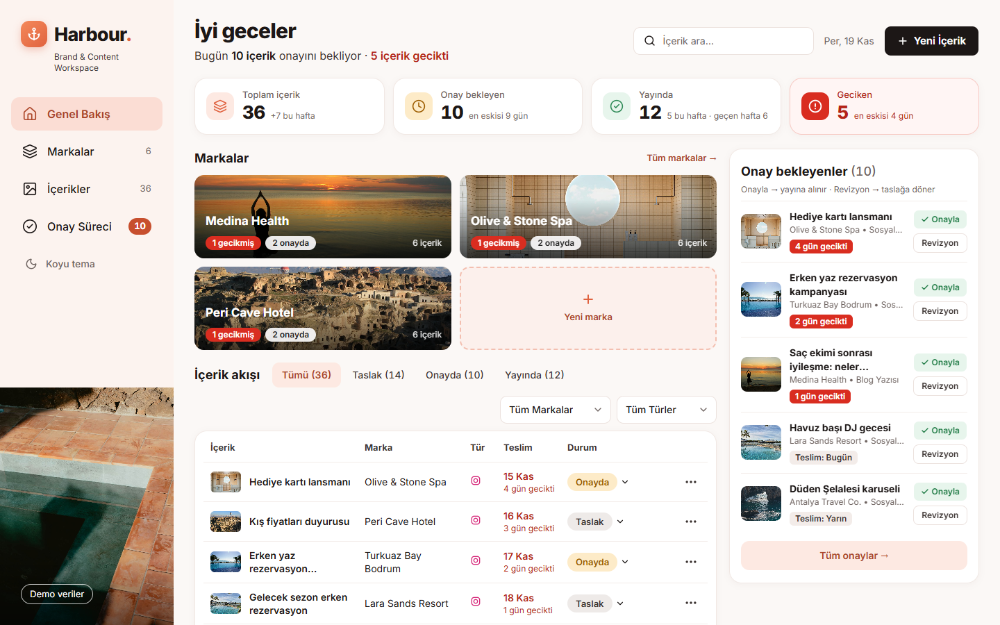

# Harbour — Client & Content Tracker

[](https://github.com/senaGitHub/client-content-tracker/actions/workflows/ci.yml)

An internal workspace for the account managers of a hospitality group's in-house agency. It tracks the group's brands (clients) and every piece of content made for them (social posts, blog posts, web pages) from draft to published.

- **Live app:** https://client-content-tracker.vercel.app
- **API docs (Swagger UI):** https://harbour-api-ke5x.onrender.com/swagger-ui.html

> The API runs on Render's free tier, which sleeps when idle. The first request after a quiet period can take about a minute; after that it is fast.



The UI is in Turkish because the users are. Code, API messages, commits and this README are in English. All brands and data are fictional demo data.

---

## Features

### Core features
- **Brands (Markalar):** a searchable grid of brands with content counts per status. Each brand has a detail page with its stats and content. You can create a new brand and pick a cover photo for it.
- **Content (İçerikler):** create and edit social posts, blog posts and web pages for a brand, with a title, type, channel, due date and notes.
- **Status pipeline:** content moves Taslak (Draft) → Onayda (In review) → Yayında (Published). A review can also send it back to Draft for revision. The server enforces this rule: any other move returns `409 Conflict`, and the UI explains why in Turkish.
- **Two views of the same content:**
  - **Board:** a kanban with drag and drop. A rejected move snaps the card back and a toast explains why.
  - **List:** filters (brand, type, due date, search), status tabs with counts, inline status changes and pagination.
- **Overdue:** computed, not stored. A due date in the past and not yet published counts as overdue. It is the only thing shown in red.
- **Overview (Genel Bakış):** KPI tiles, the brands that need attention, a content feed and the approvals queue. Every number on it comes from real data.
- **UX basics:** skeleton loading, empty states, toasts with **Geri al** (Undo), a persisted dark mode, keyboard-friendly dialogs, and a responsive layout down to 375px.

### Extras, and why
- **Approvals panel with one-click Onayla / Revizyon.** Approving is the account manager's most frequent action, so the longest-waiting items are on the first screen.
- **Activity log.** The service layer writes one row for every create, edit and status change. This one table powers three things without any fake metrics:
  - the edit sheet's history,
  - "published this week",
  - "waiting for approval for N days".
- **Undo for publishing, without breaking the rule.** Published content cannot go back on the server (see trade-offs). So every move to Yayında, wherever it starts, is held in the browser for about 5 seconds, and **Geri al** cancels it before anything is sent. Other moves are sent at once, and their Undo sends the reverse move.
- **Priority sort** (`sort=priority`): unpublished content first, oldest due date first, so overdue items lead the Overview feed.
- **Edit sheet.** Clicking content opens a side sheet instead of a new page, so you keep your place in the board or list. Status buttons in the sheet apply at once and are separate from "Save changes". The `PUT` body has no status, so saving the form can never overwrite a status change.
- **Realistic demo data.** A seeder fills an empty database with 6 brands and 36 content items. Dates are relative to the day the database was seeded, so the data looks realistic right after a seed and ages after that; I reset the demo database by hand now and then to keep it fresh.

---

## Architecture

```
 Browser ── Vue 3 SPA (Vercel) ──HTTPS/JSON──▶ Spring Boot API (Render, Docker) ──JDBC──▶ PostgreSQL (Neon)
```

**Backend** (`/backend`) — Java 21, Spring Boot 3.5, Spring Data JPA, Bean Validation, Flyway, springdoc-openapi.
- Packaged by feature: `client`, `content`, `activity`, `dashboard`, `common` (errors, CORS, seeder, paging).
- Each feature follows Controller → Service → Repository. Entities never leave the service layer, and controllers speak in record DTOs.
- The status rule lives in the domain: `ContentStatus.canTransitionTo(...)`. `ContentService` enforces it.
- Errors are RFC 7807 `ProblemDetail`s. Validation errors return 400 with per-field messages.
- The schema is owned by Flyway (`V1`, `V2`). Hibernate only validates it.
- Filters (`status`, `overdue`, `dueThisWeek`, `q`, …) are JPA Specifications. The list endpoint and the dashboard share them, so a number on the Overview always matches the list it links to.
- Paged lists return `{ items, page, size, totalElements, totalPages, hasNext }`. Sort fields are whitelisted, and an unknown field returns 400.

**Frontend** (`/frontend`) — Vue 3 (`<script setup>`), TypeScript, Vite, Vue Router, Tailwind CSS 4, shadcn-vue (reka-ui), vue-sonner, vue-draggable-plus, date-fns.
- `views/` holds the four pages. `components/` is grouped by area (`content`, `client`, `overview`, `layout`, plus shadcn `ui`).
- `composables/` holds shared state and behaviour: content query state in the URL, deferred publish, status changes with Undo, nav counts, theme.
- `api/` is a small typed fetch client. `lib/errors.ts` maps API errors (409, field errors) to Turkish text.
- Every colour is a CSS variable mapped to shadcn tokens, with a dark set under `.dark`.

**Deploy**
- **Database:** Neon Postgres.
- **API:** Render (Docker), Blueprint in `render.yaml`. Only `backend/**` changes redeploy it.
- **SPA:** Vercel. `frontend/vercel.json` rewrites every path to `index.html`.
- **Configuration:** secrets and allowed CORS origins come from environment variables.

---

## Decisions & trade-offs

- **Publishing is deferred, not reversible.** The status rule stays strict: `PUBLISHED → IN_REVIEW` is never allowed. Undo for a publish works by delaying the request for about 5 seconds in the browser.
  - **Cost:** a publish reaches the server about 5 seconds late.
  - **Mitigation:** a pending publish is sent immediately if the user leaves the page or closes the tab (`pagehide` with `fetch(..., { keepalive: true })`).
  - **Why not a "revert" transition?** It would weaken the rule that published content is final.
- **The "overdue" rule exists in three places.** It is defined once as a Specification (`ContentSpecifications.overdue`) and used by the list filter and the dashboard. Two other places repeat it:
  - `Content.isOverdue(today)` sets the `overdue` flag on each response.
  - The `countOverdueByClient` JPQL query counts overdue items per brand with a `GROUP BY`, which a Specification can't express.

  A real fix would compute per-brand counts through the Criteria API using the same predicate. For an MVP, three short, tested copies of one simple rule were cheaper.
- **The cover photo list is mirrored.** `frontend/src/lib/covers.ts` repeats the backend's `CoverImages` allow-list because there is no endpoint for it. A new cover must be added in both.
- **The Brands grid loads one page of 100** (the API maximum) instead of paginating. At agency scale (tens of brands) this is simpler, and search covers the rest.
- **The Board scrolls sideways instead of collapsing.**
  - From 768px up, columns keep a 280px minimum and the board scrolls horizontally when they don't fit, for example on a small laptop next to the sidebar. Drag and drop scrolls automatically near the edges.
  - Below 768px the board shows one column at a time, with tabs, and cards move through their menu.
- **One database for dev and prod.** A single managed Neon instance was used for both to save time. In a real project: Docker Compose locally, Testcontainers in tests, and a managed database in production.
- **Thin tests on purpose.** The only test is a focused unit test for the status transition rule, the one piece of logic that must never regress. CI type-checks and builds everything else.
- **Accessibility.** Text contrast meets WCAG AA (4.5:1) in both themes. Several design colours were darkened slightly during polish to get there. Input borders are deliberately left below WCAG 1.4.11's 3:1 for non-text contrast, to keep the design's soft look. Fields are still identified by their visible labels. Status dots are also below 3:1, but they always sit next to a text label.
  - Dialogs trap focus, start in their first field, and return focus to the button that opened them.
  - Every icon-only button has a label.
  - The board has a keyboard alternative to drag and drop: each card's menu.
- **"Marka", not "Müşteri".** The UI says "Marka" instead of "Müşteri" because an in-house agency's clients are the group's own brands.

### Out of scope (on purpose)
- **Authentication.** It is an internal panel and the brief didn't ask for it, so the Overview greets by time of day, not by name.
- **Deleting anything, and editing brands.**
- **Multi-module Maven and SSR/Nuxt.** A single Spring Boot app and a plain SPA are enough for an internal tool.
- **Separate dev and prod databases** (see above).

---

## What's next

1. Auth (company SSO) and roles, so only approvers can publish. This would also give a real name in the greeting.
2. Comments and @mentions on content, building on the activity log.
3. Editing and archiving brands, and soft-deleting content.
4. Integration tests with Testcontainers for the services and the dashboard queries, and Playwright for the main flows.
5. Calendar view by due date, and notifications for items that become overdue.
6. Serve the cover list from the API, and compute per-brand overdue counts from the shared Specification.
7. Optimistic locking. Content has no `@Version`, so two concurrent status changes (say IN_REVIEW → PUBLISHED and IN_REVIEW → DRAFT) can both pass the transition check, and the last write wins. That can break "published is final", and the same goes for concurrent PUT edits. The fix is a `@Version` column (Flyway V3) and mapping `ObjectOptimisticLockingFailureException` to 409.
8. A link field per content (the draft doc or the published post URL), since Harbour tracks the work, not the asset itself.

---

## Run it locally

**Prerequisites:** Docker. For frontend development you also need Node 20.19+ or 22.12+ (CI uses Node 24).

### Backend + database in one command
```bash
docker compose up --build
```
This starts PostgreSQL 17 and the API. The empty database is seeded with demo data on first start.
- API: http://localhost:8080/api/dashboard
- Swagger UI: http://localhost:8080/swagger-ui.html

### Frontend
```bash
cd frontend
cp .env.example .env.development.local   # VITE_API_BASE_URL=http://localhost:8080
npm install
npm run dev                              # http://localhost:5173
```
The API allows `http://localhost:5173` by default (`CORS_ALLOWED_ORIGINS`).

### Backend without Docker
This needs Java 21 and a PostgreSQL database. Create `backend/.env` from `backend/.env.example` (`DB_URL`, `DB_USERNAME`, `DB_PASSWORD`), then:
```bash
cd backend
./mvnw spring-boot:run
```

### Tests
```bash
cd backend && ./mvnw verify      # status transition unit test
cd frontend && npm run build     # vue-tsc type-check + production build
```

---

## CI

GitHub Actions (`.github/workflows/ci.yml`) runs on every push to `main` and on every pull request. It has two parallel jobs:
- **Backend:** Temurin 21 and `./mvnw -B verify`.
- **Frontend:** Node 24, `npm ci` and `npm run build`. The build includes the `vue-tsc` type check.

The workflow passed on its first run (commit `ad0f5b1`), and the badge at the top shows the latest result.

---

## AI usage

- **Implementation:** done with **Claude Code** (Claude Opus 5.5) in the repository, working phase by phase from a written plan (`CLAUDE.md`).
- **Planning and review:** plan review, visual QA against the design mockups, and decision-making happened in a **separate Claude chat**.
- **Owner's role:** I wrote the brief into `CLAUDE.md`, approved each phase's plan before any code was written, and chose between the options the AI proposed (for example extending the 5-second undo to every publish, and letting the board scroll sideways instead of collapsing to one column). Every phase was checked before commit — in the browser at different widths and in both themes — and this review caught real bugs, such as a router pattern that made brand pages 404 on refresh and a list that opened with old published items first.

---

## Photo credits

All photos are from [Unsplash](https://unsplash.com) and used under the [Unsplash License](https://unsplash.com/license). They were resized and re-compressed for the web. The brands they illustrate are fictional. The same list is in [`frontend/public/images/CREDITS.md`](frontend/public/images/CREDITS.md).

| File | Photo | Photographer |
|---|---|---|
| `covers/infinity-pool.jpg` | [Blue infinity pool fronting the sea](https://unsplash.com/photos/GyIbocv5DQY) | [Peter Lawrence](https://unsplash.com/@chesterfordhouse) |
| `covers/cappadocia-balloon.jpg` | [Hot air balloon in Cappadocia](https://unsplash.com/photos/8qsWZWrTIBE) | [Thomas Griggs](https://unsplash.com/@viajeenparacaidas) |
| `covers/palm-pool.jpg` | [A large swimming pool surrounded by palm trees](https://unsplash.com/photos/DU0weS-Yxhs) | [Nico Smit](https://unsplash.com/@nicosmit99) |
| `covers/spa-pool.jpg` | [Modern bathroom with a small pool and round window](https://unsplash.com/photos/O_E78mH4J5A) | [Ela De Pure](https://unsplash.com/@eladepure) |
| `covers/antalya-cliffs.jpg` | [Rocky cliffs frame a sparkling ocean inlet](https://unsplash.com/photos/PcmXa54jfoA) | [engin akyurt](https://unsplash.com/@enginakyurt) |
| `covers/seaside-yoga.jpg` | [Woman doing yoga near calm water at golden hour](https://unsplash.com/photos/2hKNq2rX93g) | [Lāsma Artmane](https://unsplash.com/@lasmaa) |
| `covers/olive-table.jpg` | [Table setting with an olive branch](https://unsplash.com/photos/K_DV89F2r_k) | [micheile henderson](https://unsplash.com/@micheile) |
